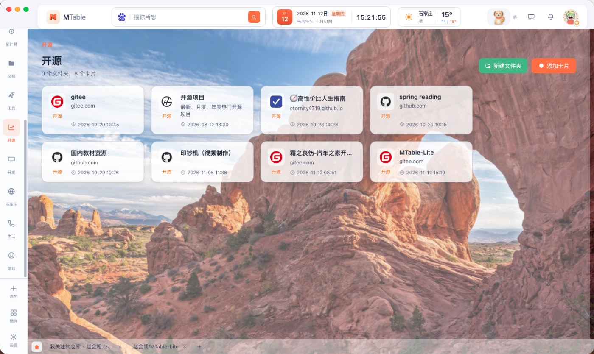
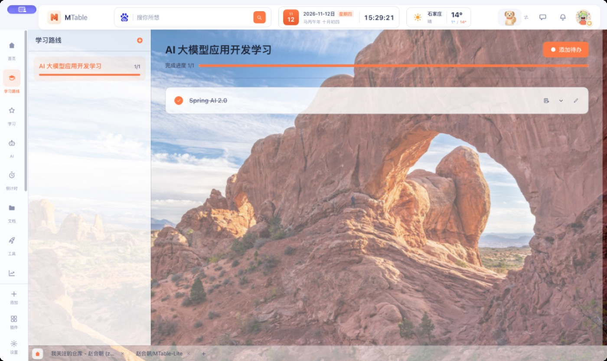
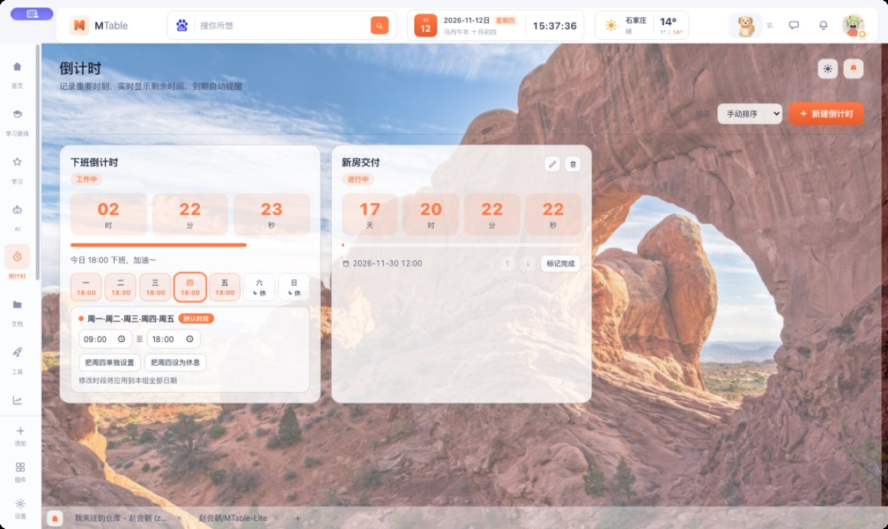
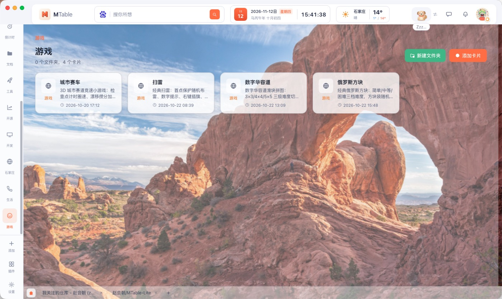
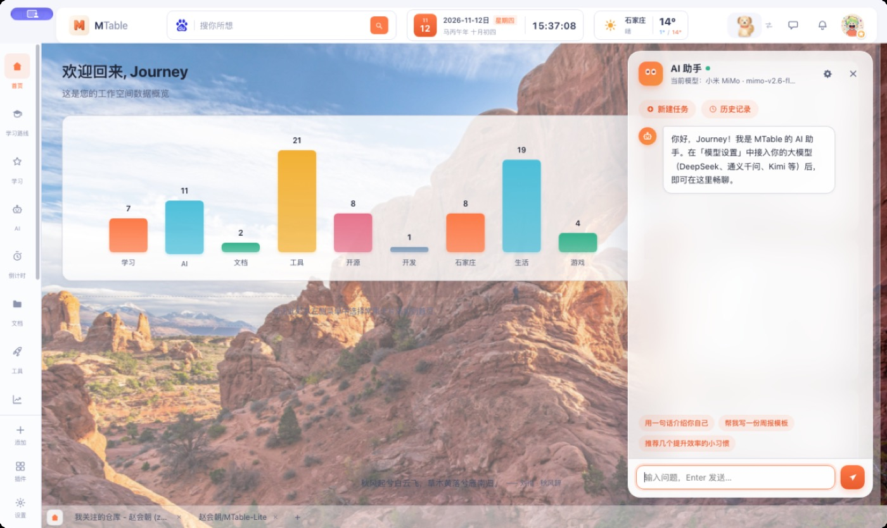
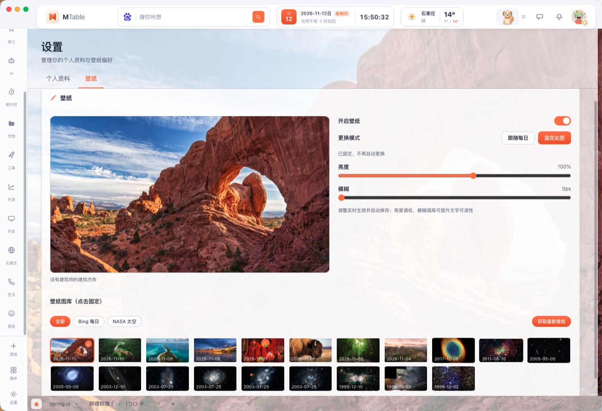
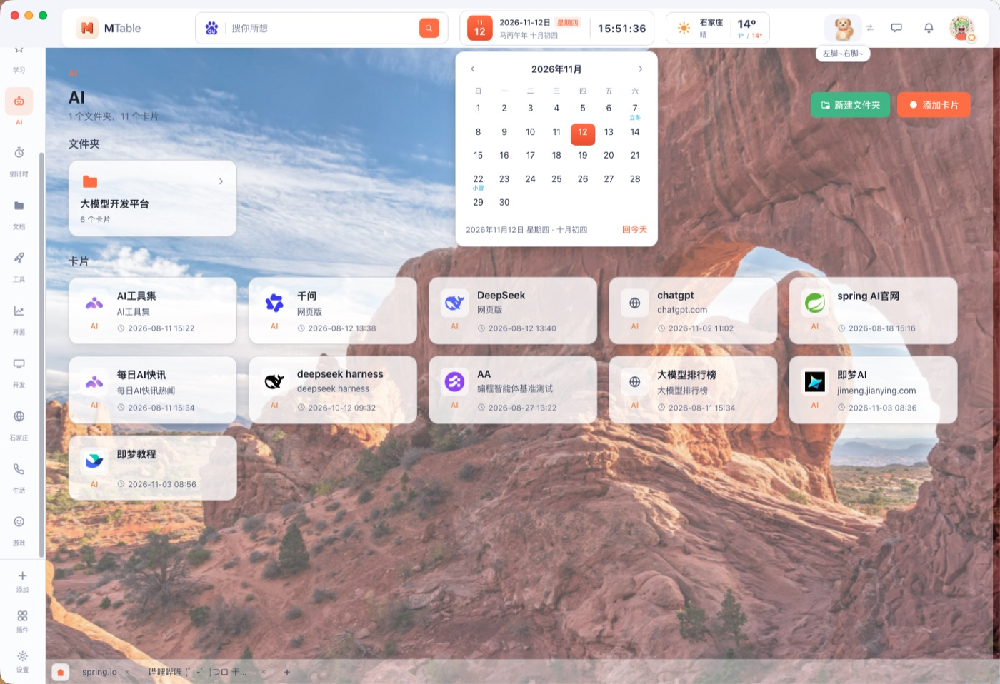
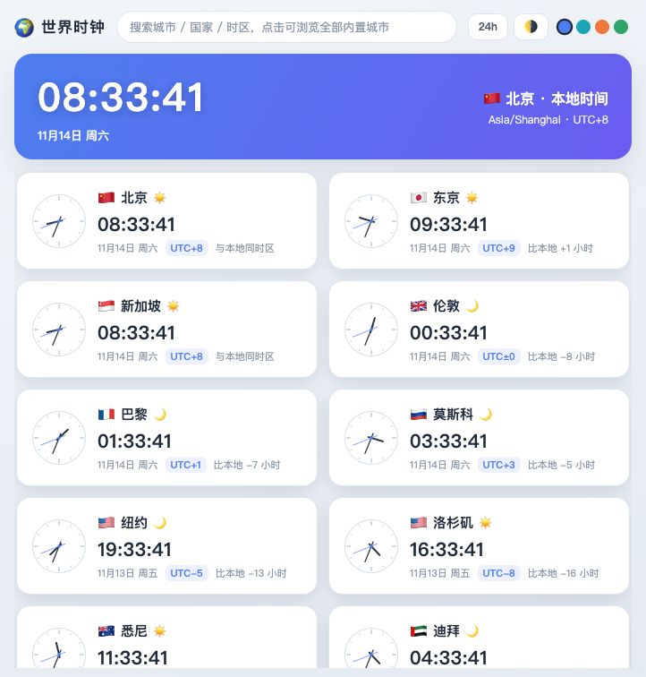

# MTable-Lite

**macOS / Windows 双平台、零后端、纯离线的本地桌面工作台** —— 双击即用的 Electron 应用，所有数据保存在本地 SQLite，不依赖任何服务器。

MTable-Lite 把「个人工作台」装进一个桌面应用：可定制的菜单与卡片、便签、学习路线、AI 助手、插件市场、内置小游戏、壁纸系统、天气/热搜聚合，全部运行在你的机器上。

<p>
  
  
  
  
</p>

## 目录

- [界面预览](#界面预览)
- [为什么选择 MTable-Lite](#为什么选择-mtable-lite)
- [功能一览](#功能一览)
- [技术架构](#技术架构)
- [快速开始](#快速开始)
- [数据文件位置](#数据文件位置)
- [项目结构](#项目结构)
- [需要联网的功能](#需要联网的功能)
- [测试](#测试)
- [插件扩展](#插件扩展)
- [FAQ](#faq)
- [已知限制](#已知限制)
- [Contributing](#contributing)
- [License](#license)

---

## 界面预览

| 工作台 | 学习路线 | 倒计时插件 |
|---|---|---|
|  |  |  |
| **自定义菜单与卡片、壁纸背景** | **路线 → 阶段 → 待办三层规划** | **插件市场一键安装** |

| 内置游戏 | 插件市场 | AI 助手 |
|---|---|---|
|  |  |  |
| **4 款内置小游戏卡片** | **按需安装 / 卸载插件** | **悬浮入口 + 流式对话** |

| 内置浏览器 | 壁纸系统 | 日历 / 农历 |
|---|---|---|
|  |  |  |
| **多标签页 + 前进后退工具栏** | **Bing / NASA 图库、亮度模糊调节** | **农历、节气、法定节假日** |

| 世界时钟插件 | | |
|---|---|---|
|  | | |
| **60 城实时时间、时区自动转换、多主题** | | |

---

## 为什么选择 MTable-Lite

- **无需后端、无需数据库服务**：传统方案需要 Electron + Spring Boot + MySQL 三件套；MTable-Lite 将数据层内嵌为本地 SQLite 文件，`npm start` 即可运行，打包产物双击即用。
- **数据完全本地化**：菜单、卡片、便签、学习路线、AI 配置、壁纸设置等全部写入 `db/app.db`，关闭应用后持久保留；可用任意 SQLite 客户端打开查看，不上传任何业务数据。
- **隐私友好**：密码本地 scrypt 加密；AI 模型密钥仅保存在本地，对话由主进程直连你所配置的厂商。
- **开箱即用的完整功能**：22 个视图模块 + 4 个内置游戏 + 世界时钟等卡片插件 + 插件市场，覆盖效率工具与娱乐。
- **macOS / Windows 双平台原生支持**：同一套代码同时产出两个平台的安装包，数据格式完全一致，可在 Mac 与 Windows 之间直接拷贝 `db/app.db` 迁移全部数据；一条脚本完成双平台打包，支持本地版本发布与应用内更新。

| 平台 | 安装包 | 架构 | 数据目录 |
|---|---|---|---|
| macOS | `MTable-<版本>-mac.dmg` | Apple Silicon (arm64) | `~/Library/Application Support/MTable/` |
| Windows | `MTable-<版本>-windows.exe`（NSIS 安装器） | x64 | `%APPDATA%\MTable\` |

## 功能一览

| 模块 | 说明 |
|---|---|
| 工作台（Dashboard） | 自定义菜单 + 卡片布局，支持文件夹分组、排序、卡片数统计 |
| 内置浏览器 | 多标签页网页浏览，底部标签切换条、前进/后退/刷新工具栏、全屏切换 |
| 快捷搜索 | 顶栏搜索框支持**百度 / 必应 / 谷歌**三种引擎一键切换 |
| 日历 / 天气 | 顶栏日历含农历、24 节气、法定节假日；天气卡片支持自定义城市 |
| 便签 | 今日便签 / 长期便签 / 历史记录 |
| 学习路线（Roadmap） | 路线 → 阶段 → 待办三层结构，自动汇总待办数/完成数 |
| AI 助手 | 首页右下角悬浮入口 + 右侧滑出面板：多模型配置（OpenAI 兼容接口）、流式对话、任务保存，密钥本地存储 |
| 插件市场 | 内置插件目录，支持安装/卸载，可扩展卡片类型（如倒计时、俄罗斯方块、世界时钟） |
| 内置游戏 | 城市狂飙（city-racer）、扫雷、数字华容道、俄罗斯方块 |
| 世界时钟 | 60 个全球主要城市实时时间，IANA 时区与夏令时自动转换、跨日日期同步，按国家分组的内置城市列表 + 关键字搜索、常用城市收藏、12/24 小时制、深浅色多主题与响应式布局 |
| 壁纸系统 | 自动拉取 Bing / NASA 每日壁纸落盘，本地协议 `wallpaper://` 加载，支持亮度/模糊调节与收藏置顶 |
| 信息聚合 | 热搜、今日一言、网站图标自动抓取 |
| 桌面宠物 | 顶栏柴犬互动彩蛋，可切换伙伴 |
| 通知与反馈 | 管理员发布通知、用户接收与未读数；用户反馈提交 |
| 账号体系 | 本地注册/登录，普通用户/管理员角色，「首页」菜单保护 |
| 版本管理 | 管理员本地发布版本 + 上传安装包，客户端应用内下载更新 |

## 技术架构

```
┌─────────────────────────────────────────────┐
│  Renderer（纯 HTML/CSS/JS，无框架）          │
│  22 视图 · 4 游戏 · 插件 · 壁纸 · 主题       │
├────────────────── IPC ──────────────────────┤
│  Preload：api / aiChat / upload 安全桥       │
├─────────────────────────────────────────────┤
│  Main（Electron 主进程）                      │
│  api.js 本地路由 → db.js（SQLite, WAL）      │
│  external.js → LLM / 热搜 / Bing·NASA 壁纸   │
│  自定义协议 wallpaper:// download://         │
└─────────────────────────────────────────────┘
```

- **渲染层 ↔ 主进程**：统一 IPC 通道 `mtable:api`，返回结构 `{ code, message, data }`，接口风格与 REST 一一对应。
- **持久层**：`better-sqlite3`，17 张业务表 + 会话表，首次启动自动建库建表并预置演示数据。
- **鉴权**：本地会话表 `t_session`，密码 scrypt 哈希（兼容 BCrypt 迁移数据），无服务端 Token。
- **外部调用**：仅 AI 对话、热搜、壁纸、天气等公开服务由主进程 Node 直连，其余全部离线。

**技术栈**：Electron 33 · better-sqlite3（WAL 模式）· 原生 HTML/CSS/JS（无前端框架）· electron-builder（dmg / NSIS）

## 快速开始

### 环境要求

- macOS（Apple Silicon）或 Windows 10/11（x64）
- Node.js ≥ 18
- 首次运行会自动创建 `db/`、`media/`、`userdata/` 目录

### 开发模式

```bash
# GitHub
git clone https://github.com/zhz357/mtable-lite.git
# Gitee（国内镜像）
git clone https://gitee.com/zhaohuizhao35/mtable-lite.git
cd MTable-Lite/mtable-desktop
npm install        # postinstall 自动按 Electron ABI 重建 better-sqlite3
npm start
```

> 若启动报 `NODE_MODULE_VERSION` 不匹配：
> `npm rebuild better-sqlite3 --runtime=electron --target=$(node -p "require('electron/package.json').version")`

### 演示账号

应用首次启动预置以下本地账号（密码均为 `123456`），也可在登录页注册新账号：

| 手机号 | 角色 |
|---|---|
| `13800138000` | 普通用户 |
| `13900000000` | 管理员 |

### 打包发布

```bash
cd mtable-desktop
bash build.sh          # 双平台：macOS dmg + Windows exe，版本号自动 +1
bash build.sh mac      # 仅 macOS，同时更新本地 app/MTable.app
bash build.sh win      # 仅 Windows（NSIS）
open app/MTable.app    # 双击即用，与开发模式共用同一份数据
```

## 数据文件位置

所有数据集中在项目根目录（开发模式与打包版共用）：

```
db/app.db              # SQLite 数据库（含 -wal/-shm，勿单独删除）
media/wallpapers/      # 壁纸图片
media/downloads/       # 管理员上传的安装包
userdata/              # Chromium 运行时数据（可整体删除重建）
```

> 若将 `MTable.app` 拷贝到项目外（如 `/Applications`）运行，数据自动改用系统用户目录：
> macOS `~/Library/Application Support/MTable/`，Windows `%APPDATA%\MTable\`。

## 项目结构

```
MTable-Lite/
├── brand/                 品牌视觉（logo SVG、品牌指南）
├── docs/screenshots/      README 界面截图
└── mtable-desktop/
    ├── main.js            Electron 主进程入口（协议注册、窗口）
    ├── preload.js         渲染进程 ↔ 主进程 IPC 安全桥
    ├── main/              主进程模块
    │   ├── db.js          SQLite 初始化与工具
    │   ├── api.js         本地 API 路由
    │   ├── ipc.js         IPC 通道注册
    │   ├── external.js    LLM / 热搜 / 壁纸等外部服务
    │   └── paths.js       数据路径统一入口
    ├── renderer/          渲染进程
    │   ├── js/views/      22 个视图模块
    │   ├── js/            api 桥、store、主题、壁纸、更新器
    │   ├── game/          4 个内置游戏 + 世界时钟（card 型插件）
    │   └── css/           样式
    ├── db/ media/ userdata/   本地数据目录
    ├── app/               本地打包的 MTable.app
    ├── build/             打包图标资源
    ├── scripts/           版本号 / dist 清理脚本
    ├── test/              数据层端到端自测
    ├── docs/              插件开发文档
    └── build.sh           发布版打包脚本
```

## 需要联网的功能

以下功能需访问公开外部服务（其余全部离线）：

- **AI 助手对话**：需在「AI 助手 → 模型设置」添加并启用一个大模型配置（API 地址 + 密钥 + 模型 ID）。未配置时提示「尚未配置大模型」。
- **热搜 / 天气 / 今日一言 / 网站图标 / Bing·NASA 壁纸**：直连公开 API，行为取决于网络状况。

## 测试

```bash
cd mtable-desktop
node test/main-test.js     # 数据层端到端自测（38 项）
node test/persist-read.js  # 跨进程持久化验证
```

## 插件扩展

工作台卡片支持插件化扩展，参考 `mtable-desktop/docs/` 下的插件设计文档（倒计时插件、俄罗斯方块插件、世界时钟插件示例）。

## FAQ

**Q：如何重置所有本地数据？**
删除 `db/` 目录后重新启动，应用会自动重建数据库并预置演示账号。

**Q：如何从旧版 MTable（Spring Boot + MySQL）迁移数据？**
将旧项目的 SQLite 备份或导出文件放置后，在「设置 → 个人资料 → 导入项目数据」选择 `db/app.db` 全量覆盖本机数据；BCrypt 哈希的账号密码可直接兼容登录。

**Q：AI 助手不工作？**
先在「AI 助手 → 模型设置」添加并启用一个大模型配置（OpenAI 兼容接口：API 地址 + 密钥 + 模型 ID），密钥仅保存在本地。

**Q：为什么仓库里没有 `db/`、`media/`、`userdata/`？**
这些是本地用户数据与生成内容，已加入 `.gitignore`；首次启动会自动创建，保证仓库干净与隐私安全。

## 已知限制

- 无远程更新服务器：版本更新基于本地发布记录，适合个人/小团队自托管场景。
- 单用户本地应用：多设备同步不在设计范围内。

## Contributing

欢迎提交 Issue 和 Pull Request：

1. Fork 本仓库并创建特性分支
2. 遵循现有代码风格（渲染层原生 JS，主进程 CommonJS）
3. 数据层改动请同步运行 `test/` 下自测脚本
4. 提交 PR 并描述变更动机

## License

[MIT](LICENSE)
